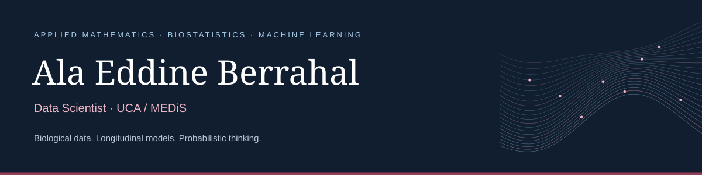

**[Portfolio en français](https://alaberrahal.github.io/fr/) · [LinkedIn](https://www.linkedin.com/in/ala-eddine-berrahal-726a81327) · [English version](README.md)**

Je suis **ingénieur en analyse de données à l’Université Clermont Auvergne**, au sein de l’**UMR 454 MEDiS**, avec une formation en mathématiques appliquées et en machine learning. Je m’intéresse aux approches statistiques pour les données complexes, en particulier biologiques et longitudinales.

### Actuellement

Depuis novembre 2026, je travaille sur les **biostatistiques et le machine learning appliqués aux données de microbiomes**, avec pour objectif de contribuer au développement de diagnostics prédictifs en périnatalité, sous la responsabilité du Pr Pierre Peyret.

### Expériences de recherche

| Période | Établissement | Sujet |
| :--- | :--- | :--- |
| **Nov. 2026 – aujourd’hui** | **Université Clermont Auvergne · MEDiS** | Données de microbiomes, biostatistiques et machine learning |
| **Avr. – sept. 2026** | **INRAE · UNH / PFEM** | Métabolomique longitudinale, modèles mixtes / LMMS, TimeOmics, classification et stabilité par bootstrap |
| **Mars – sept. 2025** | **LOCIE · Université Savoie Mont Blanc** | Modélisation probabiliste de la performance énergétique des bâtiments, inférence bayésienne et séries temporelles |

### Méthodes et outils

- **Modélisation statistique :** modèles mixtes et hiérarchiques, GLM, inférence bayésienne, processus gaussiens, ARIMA/ARMAX et modèles de Markov cachés.
- **Machine learning :** régression régularisée, SVM, forêts aléatoires, réduction de dimension, classification non supervisée et réseaux de neurones.
- **Calcul scientifique :** Python, R, NumPy, pandas, scikit-learn, PyMC, ArviZ, lmms, mixOmics / TimeOmics, Plotly, rpy2 et Git.

### À découvrir

- **[Portfolio scientifique](https://alaberrahal.github.io/fr/)** — mon parcours, mes méthodes et mes expériences de recherche, en français et en anglais.
- **[poem](https://github.com/AlaBerrahal/poem)** — dépôt public lié à mon stage au LOCIE, fork du [dépôt de Simon Rouchier](https://github.com/srouchier/poem). Les auteurs et l’historique sont indiqués dans le dépôt.

Les rubriques INRAE et UCA décrivent des expériences de recherche ; les notebooks d’analyse originaux et les données biologiques ne sont pas publiés dans ce dépôt de profil.

### Formation

**Master 2 — Mathématiques appliquées et machine learning pour l’ingénierie**, Université Jean Monnet, Saint-Étienne, parcours Math en Action avec Mines Saint-Étienne (2025).  
**Master 2 — Mathématiques appliquées**, Algérie (2023).

Basé à **Clermont-Ferrand, France**. Pour échanger autour des biostatistiques, des données longitudinales et de la modélisation probabiliste : **[LinkedIn](https://www.linkedin.com/in/ala-eddine-berrahal-726a81327)**.
