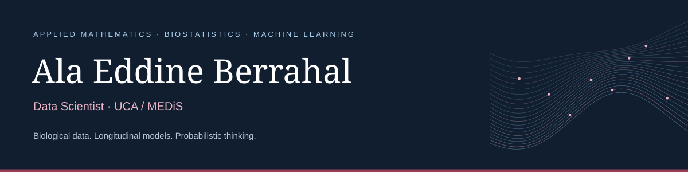

**[Portfolio](https://alaberrahal.github.io) · [LinkedIn](https://www.linkedin.com/in/ala-eddine-berrahal-726a81327) · [Version française](README.fr.md)**

I am a **Data Analysis Engineer at Université Clermont Auvergne**, in **UMR 454 MEDiS**, with a background in applied mathematics and machine learning. My work focuses on statistical approaches for complex data, particularly biological and longitudinal data.

### Currently

Since November 2026, I have been working on **biostatistics and machine learning applied to microbiome data**, with the aim of contributing to predictive diagnostics in perinatal health, under the supervision of Prof. Pierre Peyret.

### Research experience

| Period | Institution | Focus |
| :--- | :--- | :--- |
| **Nov 2026 – present** | **Université Clermont Auvergne · MEDiS** | Microbiome data, biostatistics and machine learning |
| **Apr – Sep 2026** | **INRAE · UNH / PFEM** | Longitudinal metabolomics, mixed models / LMMS, TimeOmics, clustering and bootstrap stability |
| **Mar – Sep 2025** | **LOCIE · Université Savoie Mont Blanc** | Probabilistic modelling of building energy performance, Bayesian inference and time series |

### Methods & tools

- **Statistical modelling:** mixed and hierarchical models, GLMs, Bayesian inference, Gaussian processes, ARIMA/ARMAX and hidden Markov models.
- **Machine learning:** regularised regression, support vector machines, random forests, dimensionality reduction, clustering and neural networks.
- **Scientific computing:** Python, R, NumPy, pandas, scikit-learn, PyMC, ArviZ, lmms, mixOmics / TimeOmics, Plotly, rpy2 and Git.

### Explore

- **[Research portfolio](https://alaberrahal.github.io)** — my background, methods and research experience, in English and French.
- **[poem](https://github.com/AlaBerrahal/poem)** — a public repository related to my LOCIE internship, forked from [Simon Rouchier’s repository](https://github.com/srouchier/poem). See the repository for authorship and history.

The INRAE and current UCA entries above describe research experience; the original analysis notebooks and biological data are not published in this profile repository.

### Education

**Master 2 — Applied Mathematics and Machine Learning for Engineering**, Université Jean Monnet, Saint-Étienne, Math en Action pathway with Mines Saint-Étienne (2025).  
**Master 2 — Applied Mathematics**, Algeria (2023).

Based in **Clermont-Ferrand, France**. I welcome scientific exchanges about biostatistics, longitudinal data and probabilistic modelling through **[LinkedIn](https://www.linkedin.com/in/ala-eddine-berrahal-726a81327)**.
